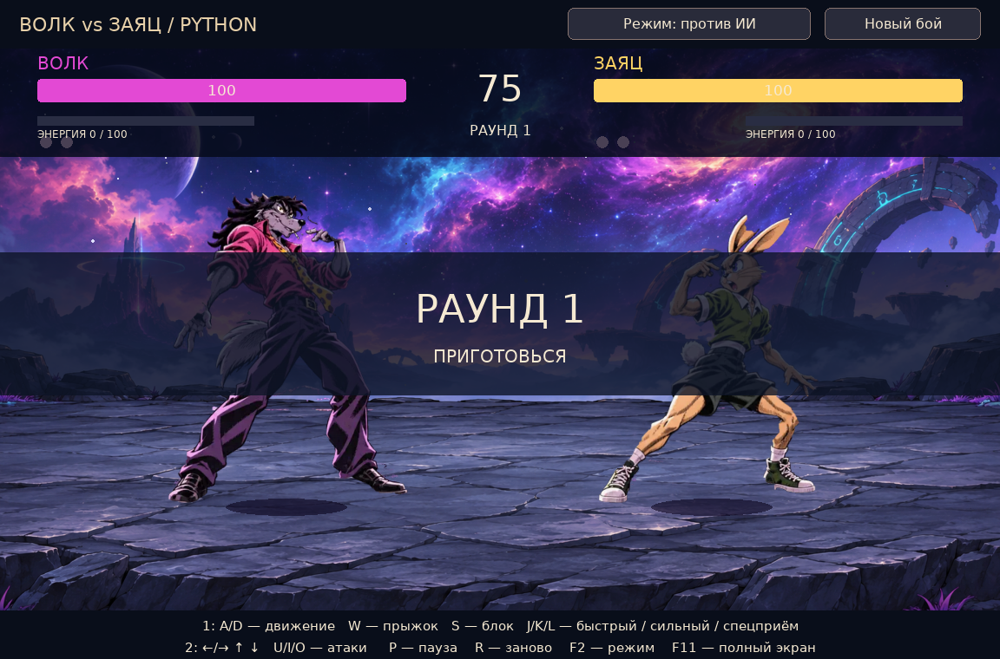
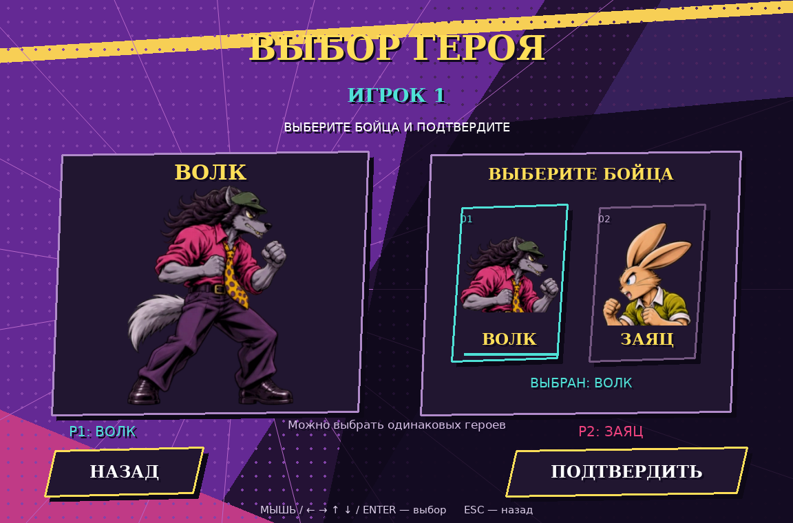
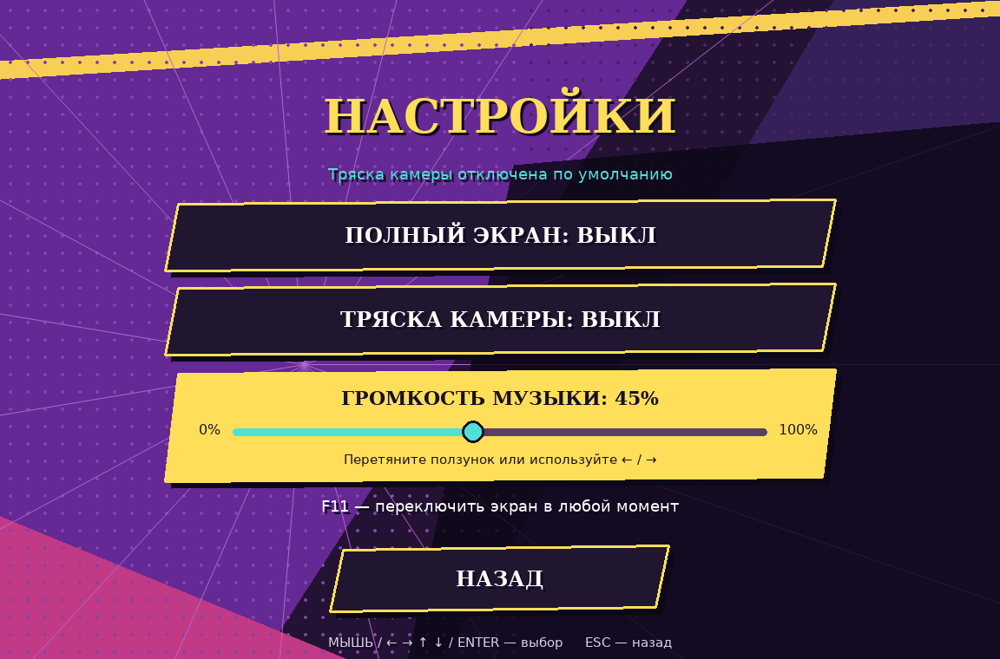
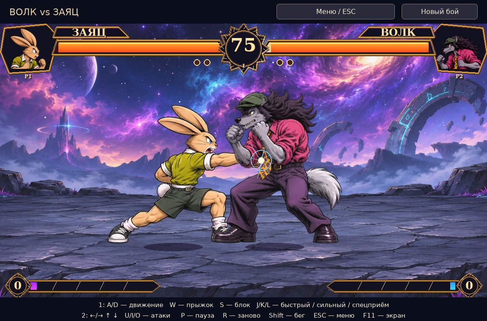

# Волк против Зайца — версия 5

Настольный файтинг на Python. Новое главное меню с оригинальным оформлением в духе JoJo: фиолетово-жёлтая палитра, диагональные панели, растровые точки, крупная типографика и комиксные акценты.



## Скачать и запустить на Windows

1. Скачайте [архив игры](wolf_vs_rabbit_python.zip?raw=true) и распакуйте **целиком в новую папку**.
2. Установите **Python 3.13, 64-bit**. Также поддерживаются Python 3.10–3.12, 64-bit. Python 3.15 для закреплённого Pygame не подходит; его можно оставить установленным параллельно с 3.13.
3. Запустите `start.bat`. При первом запуске нужен интернет: скрипт создаст отдельную среду и установит `pygame-ce==2.5.7`. Далее игра работает офлайн.

[Официальный установщик Python 3.13 для Windows, 64-bit](https://www.python.org/ftp/python/3.13.9/python-3.13.9-amd64.exe).

Новых библиотек для запуска этой версии не требуется. Промежуточные кадры уже подготовлены и включены в архив. Компилятор Visual C++ не нужен.

## Меню и выбор героев

- **Игрок против игрока** — сначала выберите героя игрока 1, затем героя игрока 2.
- **Игрок против ИИ** — выберите своего героя, затем героя компьютерного соперника.
- Доступны **Волк** и **Заяц**. Можно поменять их сторонами или выбрать одинаковых героев. Выбор меняет реального бойца, его анимации, портрет, имя и направление спрайтов.
- **Настройки** — полный экран, тряска камеры и громкость музыки. Полный экран также переключается клавишей F11.
- Мышь: нажмите карточку героя и «Подтвердить»; на втором шаге нажмите «Начать бой». Клавиатура: стрелки, Enter, Esc. При выборе героя работают также A/D, J/U.
- Во время боя P или Esc открывают паузу. Отсюда можно продолжить бой, открыть настройки или вернуться в главное меню. Возврат из настроек сохраняет текущий бой.





## Музыка

Включён присланный трек **Bloody Stream**. Он воспроизводится по кругу в меню и во время боя, без перезапуска при смене сцен. В «Настройках» доступен ползунок громкости **0–100%**: перетащите мышью или выберите его стрелками ↑/↓ и измените значение ←/→. Home — 0%, End — 100%. Изменение слышно сразу, значение сохраняется между запусками. Начальная громкость — 35%; 0% выключает звук. Старые настройки автоматически дополняются новым параметром.

Если аудиоустройство недоступно, игра продолжит работать, а в настройках появится сообщение. Новых библиотек для воспроизведения MP3 не нужно: используется Pygame.

## Плавность анимаций

- Сохранены все десять действий: стойка, ходьба, бег, прыжок, блок, лёгкий удар, сильный удар, спецприём, получение урона и падение.
- Подготовлены **24 фазы на действие** — 480 кадров для двух персонажей. Они интерполированы из прежних ключевых поз; это не 480 независимо нарисованных кадров.
- Выровнено положение корпуса между позами: устранены смещения, достигавшие примерно 100 пикселей в циклах бега. Ударная поза и момент попадания согласованы.
- Положение бойцов сглаживается между шагами физики. Физика обновляется с постоянным шагом 120 раз в секунду, отрисовка — до 60 кадров в секунду.
- Случайная тряска камеры по умолчанию выключена. Короткая остановка при контакте сокращена до 12–35 мс. При желании тряску можно включить в настройках.
- Сохраняются контактные искры, отдача, блок, шкалы здоровья и энергии, портреты и имена выбранных героев.



## Управление в бою

| Действие | Игрок 1 | Игрок 2 |
|---|---|---|
| Движение | A / D | ← / → |
| Прыжок | W | ↑ |
| Блок | S | ↓ |
| Быстрый / сильный / специальный удар | J / K / L | U / I / O |
| Бег | Shift + движение | Shift + движение |

P / Esc — пауза и меню. R — новый матч с выбранными героями. F11 — полный экран. Используйте английскую раскладку клавиатуры. Спецприём требует 40 энергии; энергия накапливается в бою. Раунд длится 75 секунд, матч — до двух побед.

Полноэкранный режим, тряска и громкость музыки сохраняются на вашем компьютере: Windows — `%LOCALAPPDATA%/WolfVsRabbit/settings.json`; Linux/macOS — в каталоге конфигурации пользователя `WolfVsRabbit/settings.json`. Настройки доступны и до боя, и из паузы. Соотношение сторон сохраняется в полноэкранном режиме, координаты мыши учитывают поля по краям.

## Другие способы запуска

В активированной среде Python 3.10–3.13:

```sh
python -m pip install -r requirements.txt
python main.py
```

На Linux/macOS обычно нужен `python3` вместо `python`. Можно запустить `sh start.sh` для создания локальной среды. На Linux может потребоваться пакет `python3-venv`. Не устанавливайте `pygame` и `pygame-ce` одновременно в одну среду: оба используют имя модуля `pygame`.

## Сборка Windows .exe

На Windows запустите `build_exe.bat`. Он установит PyInstaller в среду совместимого Python и создаст `dist/WolfVsRabbit/WolfVsRabbit.exe`. Переносите **всю папку** `dist/WolfVsRabbit`, включая `_internal`. На компьютере получателя Python тогда не требуется. Готовый .exe в ZIP не включён: его нужно собирать в Windows.

## Проверки и исходники

```sh
python -m unittest -v test_game test_animation test_contact test_menu test_music
```

Проверены 35 сценариев: бой, контакт, анимации, выбор героев для обоих режимов, одинаковые герои, мышь с учётом полей, навигация, пауза, сохранение настроек и переключение экрана. Графические проверки выполнялись в Linux через SDL dummy; запуск в реальном окне Windows отдельно не проверялся.

- `main.py` — окно, бой, ИИ, обработка событий и сцены.
- `menu.py`, `settings.py` — меню, выбор героев и предпочтения.
- `animation.py`, `assets/v4/` — непрерывные фазы и подготовленные кадры.
- `hud.py`, `impact.py` — панели и эффекты контакта.
- В репозитории сохранены исходные и предыдущие наборы графики; в ZIP включены только используемые этой версией ресурсы.

Фон и исходные персонажи взяты из вашего проекта, переработанные ключевые позы созданы по присланным референсам. Лицензия шрифтов DejaVu находится в `assets/FONT_LICENSE.txt`.
